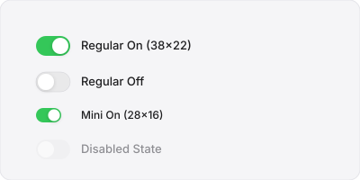
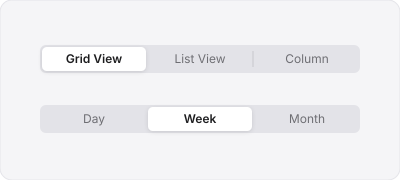
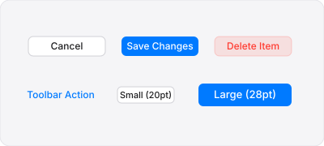
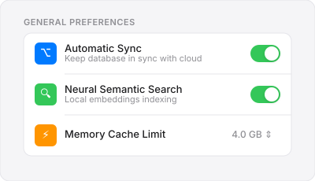
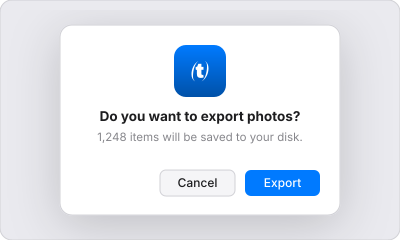

# Apple HIG for GPUI (`gpui-apple-hig`)

[](https://lavs9.github.io/HIG-GPUI/)
[](https://developer.apple.com/design/human-interface-guidelines/)
[](https://github.com/lavs9/HIG-GPUI)
[](LICENSE)

> **Live Interactive Showcase & Documentation:**  
> **👉 [https://lavs9.github.io/HIG-GPUI/](https://lavs9.github.io/HIG-GPUI/)**  
> Explore interactive components, visual state galleries (Light & Dark appearances), live accent switcher, HIG specs, and copyable Rust GPUI snippets.

---

A comprehensive, production-grade implementation of Apple Human Interface Guidelines for desktop applications written in Rust with GPUI. 
Built in accordance with [Apple HIG](https://developer.apple.com/design/human-interface-guidelines/) and [platform-design-skills](https://github.com/ehmo/platform-design-skills).

## Visual Showcase

### Toggle Switches (`MacSwitch`)


### Segmented Controls (`MacSegmentedControl`)


### Buttons (`MacButton`)


### System Settings Card Group (`MacSettingsGroup` & `MacSettingsRow`)


### Alert Dialogs & Sheets (`MacDialog`)


---

## Component Catalog

| Component | Description | HIG Metric / Spec |
|:---|:---|:---|
| **[`MacSwitch`](https://lavs9.github.io/HIG-GPUI/#switch)** | Binary toggle switch with smooth spring physics | Regular (38×22pt), Mini (28×16pt), `#34C759` Green |
| **[`MacCheckbox`](https://lavs9.github.io/HIG-GPUI/#checkbox)** | Checkbox with unchecked, checked, and mixed states | 14×14pt, 3.5pt radius, `#007AFF` Accent |
| **[`MacRadio`](https://lavs9.github.io/HIG-GPUI/#radio)** | Mutually exclusive circular radio option | 14×14pt circle with concentric dot |
| **[`MacSegmentedControl`](https://lavs9.github.io/HIG-GPUI/#segmented)** | Recessed container with elevated active pill | 28pt height, smart hairline dividers |
| **[`MacButton`](https://lavs9.github.io/HIG-GPUI/#button)** | Push, Prominent, Destructive, and Borderless | 6pt radius; 20pt (S), 24pt (M), 28pt (L) |
| **[`MacSearchField`](https://lavs9.github.io/HIG-GPUI/#search-field)** | Capsule search field with clear button | 28pt height, 14pt radius, focus ring |
| **[`MacTextField`](https://lavs9.github.io/HIG-GPUI/#text-field)** | Single-line text input & secure password field | 6pt radius, leading/trailing icons |
| **[`MacSlider`](https://lavs9.github.io/HIG-GPUI/#slider)** | Continuous and stepped range slider | 4pt track, 16pt drop-shadow thumb |
| **[`MacProgress`](https://lavs9.github.io/HIG-GPUI/#progress)** | Determinate & indeterminate shimmer bar | 6pt height, accent color fill |
| **[`MacSpinner`](https://lavs9.github.io/HIG-GPUI/#progress)** | Circular activity spinner indicator | Small (16pt), Regular (24pt), Large (32pt) |
| **[`MacStepper`](https://lavs9.github.io/HIG-GPUI/#stepper)** | Dual vertical increment/decrement chevrons | 18×24pt rounded container |
| **[`MacColorWell`](https://lavs9.github.io/HIG-GPUI/#color-well)** | Native color well with inset swatch preview | 44×24pt, 5pt radius |
| **[`MacPopupButton`](https://lavs9.github.io/HIG-GPUI/#popup-button)** | Double chevron (⇕) pop-up selection button | 24pt height, selection semantics |
| **[`MacPullDownButton`](https://lavs9.github.io/HIG-GPUI/#popup-button)** | Downward chevron (▾) action pull-down menu | 24pt height, action semantics |
| **[`MacSettingsGroup`](https://lavs9.github.io/HIG-GPUI/#settings)** | macOS System Settings rounded form card | 10pt card radius, 52pt inset dividers |
| **[`MacSidebar`](https://lavs9.github.io/HIG-GPUI/#sidebar-comp)** | Source list sidebar with selection pills & badges | 28pt row height, accent active pill |
| **[`MacDisclosure`](https://lavs9.github.io/HIG-GPUI/#disclosure)** | Collapsible progressive disclosure control | Smooth rotating triangle (▶ / ▼) |
| **[`MacDialog`](https://lavs9.github.io/HIG-GPUI/#dialog)** | Native alert dialog card with standard actions | App icon, situation title, action buttons |
| **[`MacToolbar`](https://lavs9.github.io/HIG-GPUI/#chrome)** | Unified toolbar with traffic light clearance | 52pt height, 78pt traffic clearance |
| **[`MacStatusBar`](https://lavs9.github.io/HIG-GPUI/#chrome)** | Window bottom status bar with hairline divider | 28pt height |
| **[`MacKbd`](https://lavs9.github.io/HIG-GPUI/#kbd)** | Apple keyboard shortcut glyph caps | Formats to ⌘, ⇧, ⌥, ⌃, ⎋, ↵ |
| **[`MacBadge`](https://lavs9.github.io/HIG-GPUI/#kbd)** | Semantic status indicators | Neutral, Accent, Success, Warning, Danger |

---

## Installation

Add to your `Cargo.toml`:

```toml
[dependencies]
gpui-apple-hig = { git = "https://github.com/lavs9/HIG-GPUI", branch = "main" }
gpui-kit = "0.1"
```

## Quickstart

```rust
use gpui_apple_hig::{apply_apple_theme, AppleAppearance, MacAccentColor, MacSwitch, MacButton};
use gpui::*;

fn main() {
    App::new().run(|cx: &mut AppContext| {
        // Apply native Apple palette and typography
        apply_apple_theme(cx, AppleAppearance::System, MacAccentColor::Blue);
        
        // Open window with Apple HIG controls
    });
}
```

## Documentation

Visit the interactive documentation site at **[https://lavs9.github.io/HIG-GPUI/](https://lavs9.github.io/HIG-GPUI/)** to inspect all components in both Light and Dark modes.
